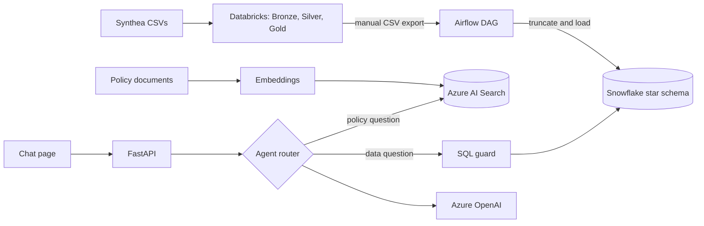

# Healthcare Claims Intelligence Platform

A portfolio project that combines a data pipeline (Databricks, Snowflake, Airflow) with an AI assistant (RAG, a SQL agent, and a web API) on **synthetic** healthcare data. No real patient data is used anywhere.

Ask it in plain English:

- "What is the physical therapy visit limit?" is answered from policy documents, with citations.
- "Which diagnosis had the highest total claim cost?" is answered by a read-only query on Snowflake.
- "Which diagnoses cost the most, and do MRIs need prior authorization?" is split between both.

## Architecture



## What is in the repo

| Path | What it does |
|---|---|
| `airflow/dags/claims_pipeline_dag.py` | Daily DAG: check files, upload to a Snowflake stage, truncate and reload, quality checks, run log |
| `make_docs.py`, `policy_docs/` | Seven fictional policy documents used for RAG |
| `build_index.py`, `upload_to_search.py` | Chunk, embed, and load into Azure AI Search |
| `ask_search.py` | Hybrid (keyword plus vector) retrieval and cited answers |
| `agent.py` | Router, text-to-SQL, and answer assembly |
| `sql_guard.py`, `test_guard.py` | SELECT-only validator and its tests |
| `api.py` | FastAPI service, chat page, and a PII-masked audit log |
| `evaluate.py` | 17-question evaluation with a pass/fail threshold |
| `.github/workflows/ci.yml` | CI: syntax check and guard tests; evaluation on manual run |

## Data pipeline

- **Source:** Synthea 1K sample (synthetic patients, encounters, conditions, providers, payers).
- **Databricks (Free Edition), PySpark and Delta:** Bronze (raw as-is with audit columns), Silver (typed, deduplicated, direct identifiers dropped), Gold (star schema).
- **Gold tables loaded into Snowflake:**

| Table | Rows |
|---|---|
| `FACT_CLAIMS` | 61,459 |
| `DIM_PATIENT` | 1,163 |
| `DIM_PROVIDER` | 5,056 |
| `DIM_PAYER` | 10 |
| `DIM_DIAGNOSIS` | 204 |
| `DIM_DATE` | 17,019 |

- **Modeling decision:** each claim is linked to its primary clinical diagnosis, preferring disorders over social findings such as employment status. Encounters without a clinical diagnosis map to an explicit `NO_DX` category, not dropped. The first version of this rule attributed cost to "employment", which was caught by checking the top-10 output.
- **Quality checks:** null keys, duplicates, negative costs, orphan keys, and file-versus-table row counts. The Airflow run fails if any check fails.
- **Airflow (Docker):** schedule, 2 retries, execution timeout, failure callback, and a `PIPELINE_RUN_LOG` table. Reloading is truncate-then-load, so reruns never create duplicates.

## Snowflake tuning (measured)

Test table: 61,459 claims repeated 300 times (about 18.4M rows) in random order. Query: top diagnoses by cost for one quarter, X-Small warehouse, result cache off.

| Version | Duration |
|---|---|
| Unsorted table | 943 ms |
| `CLUSTER BY (date_key)` | 638 ms (about 32% faster) |

One run of each, on a small table by Snowflake standards, so treat it as indicative. Cost controls: X-Small warehouse, 60-second auto-suspend.

## AI layer

- **Models:** Azure OpenAI chat (gpt-5-mini) and an embedding model.
- **RAG:** chunking, embeddings, and an Azure AI Search index with hybrid retrieval. Answers must cite the source file or say the information is unavailable.
- **Agent:** an LLM router returns DOCUMENTS, DATA, BOTH, or NEITHER, and splits combined questions into one part per tool. Text-to-SQL uses a written schema description and retries once on a SQL error.
- **Evaluation:** 17 hand-written questions covering answer correctness, correct source retrieval, out-of-scope refusal, and a prompt-injection attempt. The first run scored 15/17; both failures were a bug in my checker (curly versus straight apostrophe in refusal matching), and the assistant's answers were correct. After the fix: 17/17. This is a small regression test, not proof of general quality.

## Security and governance

- **Two independent layers stop writes:** `sql_guard.py` (single SELECT only, no comments, no system schemas, row limit) and a Snowflake role, `CLAIMS_READONLY`, that has no write privileges. Verified: a DELETE with the agent's login fails with insufficient privileges.
- **Separate service identities:** the pipeline and the agent have their own Snowflake users with key-pair authentication, and different roles.
- **Secrets:** kept in a local `.env` and `keys/`, both git-ignored. Nothing secret is committed.
- **Privacy:** synthetic data only; direct identifiers are dropped in Silver; the audit log masks emails, SSN-like numbers, and phone-like numbers.
- See [governance/responsible_ai.md](governance/responsible_ai.md).

## Run it locally

```bash
pip install -r requirements.txt
# create .env (Azure OpenAI, Azure AI Search, Snowflake settings) and keys/agent_key.p8
python make_docs.py
python build_index.py
python upload_to_search.py
python evaluate.py
python -m uvicorn api:app --port 8000
```

## Limitations (honest list)

- The Databricks export step is manual because Free Edition restricts outbound access. On a paid workspace this would be a Databricks job triggered by Airflow.
- The app runs locally. It is not deployed to Azure, and there is no infrastructure-as-code yet.
- PII masking applies to logs only. The question text still goes to Azure OpenAI. A production version would mask before the model call (for example with Microsoft Presidio) and add Azure AI Content Safety.
- Loads are full reloads, not incremental. There is no MLflow tracking and no model training.
- The evaluation set is small and uses simple keyword checks.
- Policy documents are fictional.
